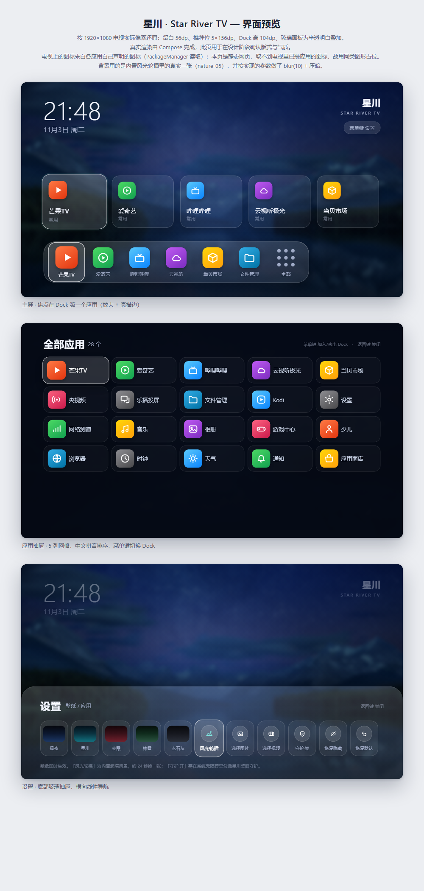

# 星川 · Star River TV

一个自用的 Android 电视桌面。视觉走 tvOS 27 的 **Liquid Glass** 路线（毛玻璃 Dock、大圆角、
纵向层次），工程结构按国产电视的现实约束来写（minSdk 21、LEANBACK/LAUNCHER 双入口、
standard / guard 双形态）。

参考了两个开源项目，各取所长：

| 参考 | 取用的部分 |
| --- | --- |
| [xinghe-desktop](https://github.com/youshoubianyouni/xinghe-desktop) | Compose 技术选型、minSdk 21 与依赖版本组合（AGP 8.12 / Kotlin 2.2 / Compose BOM 2025.11）、standard/guard 双 flavor 思路、视频壁纸 |
| [Tigris](https://github.com/lesnolie/Tigris) | 液态玻璃的视觉语言、玻璃 Dock + Top Shelf 的信息层级、PackageManager 枚举与中文排序 |

代码是重新写的，没有复制上述项目的源文件；包名、资源、交互均为本项目自有实现。



预览页 `design/preview.html` 按 1920×1080 实际像素还原版式，可直接用浏览器打开比对。

## 特性

- **真实应用图标**：从 `PackageManager` 读各应用自己声明的图标（入口图标优先，其次包图标），
  自适应图标、方形图标、宽 banner 都按比例处理，不会拉变形；只有确实没有图标的应用才回退成首字卡片
- **玻璃 Dock**：底部圆角玻璃条，末位固定「全部应用」入口，聚焦时放大 + 亮描边
- **推荐位（Top Shelf）**：按启动频次自动排序的大卡片，越用越顺手
- **应用抽屉**：全屏网格，中文拼音排序，菜单键一键加入/移出 Dock
- **壁纸**：**内置风光轮播**（6 张 3840×2160 真·风景照，24 秒交叉淡入换一张，带极慢推近/平移）
  + 5 套内置渐变 + 本地图片 + 本地视频（静音循环）。图片按 `assets/wallpapers/` 文件名排序播放，
  丢进自己的 jpg 就会自动加入轮播，不用改代码（来源与版权见 [CREDITS.md](CREDITS.md)）
- **空闲省电**：不常驻后台服务、不申请多余权限，只做桌面该做的事
- **安装即变**：装/卸应用后自动重扫，不需要重启桌面
- **双形态**：`standard` 声明 HOME 作为系统桌面；`guard` 不声明 HOME，供 TCL / 海信等
  会拦截第三方 HOME 声明的固件以普通应用方式安装
- **桌面守护（可选）**：固件把自家桌面拉回前台时，用无障碍服务立刻切回星川。
  只监听窗口切换、不读屏幕内容，默认关闭，设置面板里一键开关

## 构建

需要 JDK 17 与 Android SDK（`compileSdk 36`、`build-tools 36.0.0`）。

```bash
# 系统桌面形态
./gradlew assembleStandardRelease
# 无 HOME 声明形态（固件拦截时用）
./gradlew assembleGuardRelease
```

产物：

```
app/build/outputs/apk/standard/release/app-standard-release.apk
app/build/outputs/apk/guard/release/app-guard-release.apk
```

未提供 `local/signing.properties` 时，release 会退回到本机 debug 签名 —— 能装，但**不能覆盖升级**
已用其它签名安装的版本。要长期自用，建议先固定签名：

```properties
# local/signing.properties
storeFile=starriver.jks
storePassword=******
keyAlias=starriver
keyPassword=******
```

## 安装

完整的执行步骤（记录现场、安装、设默认桌面、验证、开启守护、回滚）写在
**[AGENTS.md](AGENTS.md)** 里，那是给「替你装电视的人或代理」看的操作手册；
要直接发给别人执行，用 **[INSTALL-PROMPT.md](INSTALL-PROMPT.md)** 里那段复制即用的指令。

最短路径：

```bash
adb connect <电视IP>:5555     # 电视需先打开 ADB 调试
adb install -r app-standard-release.apk
adb shell cmd package set-home-activity app.xingchuan.tv/.MainActivity
adb shell input keyevent KEYCODE_HOME
```

装好后按 Home 键，系统会询问默认桌面，选「星川」并勾选「始终」。

若装完按 Home 没反应，说明固件截住了 HOME 声明，改用 guard 形态安装，再从应用列表打开，
并在设置面板里把「守护·关」切成「守护·开」。

## 实机验证结果（Android 9 / 1920×1080）

| 项 | 结果 |
|---|---|
| 安装 / 升级（`install -r`） | 通过 |
| 真实应用图标 | 通过（18 个应用图标全部正确显示） |
| 风光轮播 | 通过（连拍 4 次，画面在 4 张不同风景间轮换） |
| 设置面板 11 格 / 应用抽屉 18 项 | 通过（无溢出、无截断） |
| 主页键回到星川 | 通过（**开启守护后**；未开守护时被厂商桌面接管） |
| 待机唤醒 / 开机自启 | 未测 |

这台电视的固件（`com.stv.*`）会用**显式组件**启动自家桌面，绕过 HOME 解析，
所以 `set-home-activity` 虽然 `Success`、系统偏好也写成星川（`mAlways=true`），主页键仍然去了厂商桌面。
唯一非破坏性解法是开守护，详见 [AGENTS.md](AGENTS.md) 第 6 节。

## 遥控器操作

| 键 | 主屏 | 应用抽屉 | 设置 |
| --- | --- | --- | --- |
| 左右 | 在推荐位 / Dock 内移动 | 网格内移动 | 设置项之间移动 |
| 上 | Dock → 推荐位 | 首行再按上：收起抽屉 | — |
| 下 | 推荐位 → Dock / Dock 再按下：打开抽屉 | 向下一行 | — |
| 确定 | 启动 | 启动 | 应用当前项 |
| 菜单 | 打开设置 | 加入 / 移出 Dock | 关闭 |
| 返回 | 不响应（避免弹回厂商桌面） | 关闭抽屉 | 关闭 |

## 结构

```
app/src/main/java/app/xingchuan/tv/
├── MainActivity.kt          入口、全屏、装/卸应用后重扫
├── core/
│   ├── Apps.kt              应用枚举（LEANBACK + LAUNCHER 去重）、图标解码、启动
│   ├── Icons.kt             图标解码与 LruCache（入口图标 → 包图标，宽图留边）
│   ├── Guard.kt             桌面守护：无障碍服务 + 开关状态
│   ├── BootReceiver.kt      开机自启（guard 形态用，尽力而为）
│   └── LauncherModel.kt     设置持久化 + 桌面状态（Dock / 隐藏 / 频次 / 壁纸）
└── ui/
    ├── Home.kt              主屏：竖向层次、焦点分发、Dock、推荐位
    ├── Drawer.kt            应用抽屉
    ├── Settings.kt          设置面板 + 壁纸选择器
    ├── Wallpaper.kt         渐变 / 图片 / 视频壁纸层
    ├── Glass.kt             玻璃面板、焦点缩放、图标兜底
    └── Theme.kt             配色与字阶
```

**焦点为什么不用 Compose 自带的焦点搜索**：电视上 D-pad 的行为必须可预测。这里整屏只有一个
focusable 锚点，所有方向键在 `Home.kt` 里按 index 集中分发，网格滚动用 `animateScrollToItem`
跟随。代价是放弃了无障碍遍历，收益是任何机型上按键都不会“跳飞”。

## 改成你自己的

1. 应用名：`app/src/main/res/values/strings.xml` 的 `app_name`
2. 包名：`app/build.gradle.kts` 的 `applicationId` 与 `namespace`，同时重命名
   `app/src/main/java/app/xingchuan/tv` 目录并全局替换 `app.xingchuan.tv`
3. 图标 / 横幅：`res/drawable/ic_launcher_foreground.xml`、`res/drawable/banner.xml`
4. 主题色：`ui/Theme.kt` 的 `Ink`；壁纸预设：`core/LauncherModel.kt` 的 `Presets`

## 已知限制

- 风光轮播的 6 张图来自 Bing 每日壁纸，仅限自用；换成自己的照片见 `CREDITS.md`。
- **图片/视频壁纸依赖系统文件选择器**（SAF）。部分电视固件没有 DocumentsUI，此时会提示改用
  内置壁纸。参考项目用局域网手机上传页解决，本项目暂未实现。
- **背景模糊**用 `Modifier.blur`，实际生效需 Android 12+；更低版本壁纸不模糊，玻璃面板仍为
  半透明叠加，观感略平。
- **桌面守护已在 Android 9 实机验证主页键场景**（连按 3 次均在 1.5 秒内回到星川，无闪跳）；
  **开机自启已验证**（2026-11-03 重启后直达星川，无需按键）；**待机唤醒仍未验证**，需要用户按遥控器电源键。
- 未实现：去广告、手机远程传壁纸、天气、「保持 ADB 常开」开关。
- `targetSdk 34`，侧载自用，不上架。

## 官网

`site/` 是项目主页（纯静态，无依赖、无统计脚本、无 Cookie）：需求样式参考 Tigris 官网，
内容为本项目真实资料——真机截图、实机验收记录、AGENTS.md 的安装与回滚流程。

- 本地预览：直接打开 `site/index.html`
- 改完部署：`site/` 整目录上传到任意静态托管即可（EdgeOne Pages / GitHub Pages / Cloudflare Pages）
- 两个 APK（各约 26 MB）发布在 [GitHub Releases](https://github.com/lichong152/starriver/releases)，
  页面下载按钮指向 `releases/latest/download/<文件名>`，发新版本后自动生效，不需要改页面

## 下载

| 形态 | 文件 | 适用 |
|---|---|---|
| 标准版 | [app-standard-release.apk](https://github.com/lichong152/starriver/releases/latest/download/app-standard-release.apk) | 默认选它，声明 HOME |
| 守护版 | [app-guard-release.apk](https://github.com/lichong152/starriver/releases/latest/download/app-guard-release.apk) | 固件拒绝声明 HOME 的 APK 时用 |

## 许可

MIT。参考项目的许可与版权归各自作者所有。
